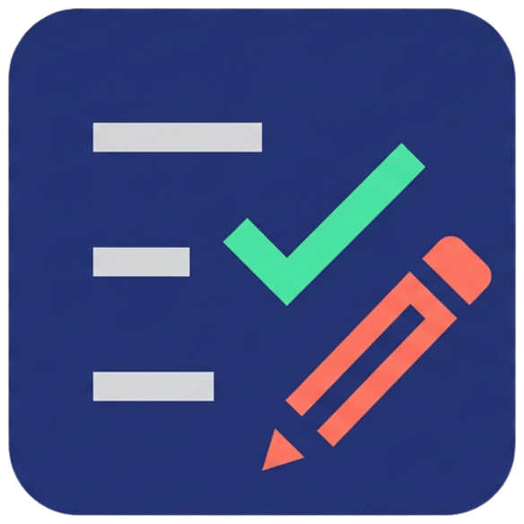

<p align="center">
  
</p>

<h1 align="center">TestForge</h1>

<p align="center">
  <strong>Sınav Kağıdı & İnteraktif Test Hazırlama Aracı</strong><br>
  <em>Professional Exam Paper & Interactive Quiz Maker</em>
</p>

<p align="center">
  <a href="#türkçe-tanıtım">🇹🇷 Türkçe Tanıtım</a> •
  <a href="#english-overview">🇬🇧 English Overview</a> •
  <a href="#nasıl-çalıştırılır--how-to-run">💻 Çalıştırma / How to Run</a>
</p>

---

<a id="türkçe-tanıtım"></a>
## 🇹🇷 Türkçe Tanıtım

**TestForge**, öğretmenlerin, eğitmenlerin ve öğrencilerin kolayca soru ve cevaplar girerek ister **resmi yazılı sınav kağıdı (A4/PDF)**, ister Google NotebookLM tarzı **modern interaktif dijital test** hazırlamasını sağlayan çift dilli ve çift modlu bir web uygulamasıdır.

### 🌐 Çift Dil Desteği (TR / EN)
- Üst gezinti çubuğundaki (navbar) **[ TR | EN ]** butonu sayesinde tüm arayüzü tek tıkla Türkçe veya İngilizceye çevirebilirsiniz.
- Varsayılan dil **Türkçe** olup, dil tercihiniz tarayıcınızda otomatik olarak hatırlanır.
- Hazırlanan **bağımsız interaktif HTML** test çıktıları da seçtiğiniz dilde oluşturulur.

### 🌟 İki Ana Çalışma Modu

1. **📄 Sınav Kağıdı Modu (Baskı & PDF Odaklı):**
   - **A4 Sayfa Düzeni:** MEB, okul ve üniversite formatında tek veya 2 sütunlu gerçek sınav kağıdı simülasyonu.
   - **Kurumsal Başlık:** Kurum/okul adı, ders adı, sınav dönemi, tarih ve yönerge alanları.
   - **Öğrenci Bilgi & Puan Kutusu:** Ad-Soyad, Sınıf, Numara ve öğretmenin not verebileceği puan kutucuğu.
   - **Optik Form & Cevap Anahtarı:** Kağıt altına opsiyonel optik işaretleme kabarcıkları ve otomatik cevap anahtarı.
   - **Çıktılar:** Vektörel A4 **PDF İndir** ve **Yazdır** (`Ctrl+P`).

2. **🎯 Test Modu (İnteraktif & Dijital Odaklı):**
   - **NotebookLM / Gemini Tarzı Minimalist Tasarım:** Kağıt sınırları olmaksızın, yuvarlatılmış modern soru kartları ve akıcı seçenek butonları.
   - **Anında Doğru / Yanlış Geri Bildirimi:** Şık tıklandığı anda doğruysa yeşil tik, yanlışsa kırmızı çarpı ve doğru cevabı gösteren görsel geri bildirim.
   - **💡 "Neden Doğru?" Çözüm Açıklaması:** Şık işaretlendiğinde sorunun altında açılan açıklayıcı ipucu/çözüm kartı.
   - **Çalışma Özeti & Analiz (Study Summary):** Test bitiminde başarı puanı, konfeti kutlaması, doğru/yanlış/boş istatistikleri ve "Soru İncelemesi & Öğrenme Notları" dökümü.
   - **Bağımsız İnteraktif HTML Çıktısı:** İnternet bağlantısı olmasa bile telefonda ve bilgisayarda çift tıklandığında anında çalışan, süre tutan ve anında puanlayan **bağımsız interaktif test** dosyası.

### ⚡ Diğer Gelişmiş Özellikler
- **Toplu Soru Aktarımı (Smart Text Parser):** Word, PDF veya yapay zeka çıktısı (ChatGPT, Claude vb.) soru bloklarını yapıştırarak saniyeler içinde teste dönüştürün.
- **Zengin Soru Tipleri:** Çoktan seçmeli (A/B/C/D/E), Doğru / Yanlış (D/Y - T/F) ve Klasik açık uçlu sorular.
- **Görsel Desteği:** Dosya seçerek veya link ile soruya resim ekleme.
- **JSON Proje Kaydetme & Yükleme:** Hazırlanan testleri kaydedip daha sonra kaldığınız yerden düzenlemeye devam edin.
- **Koyu / Açık Tema:** Gece ve gündüz kullanımına uygun modern tema desteği.

---

<a id="english-overview"></a>
## 🇬🇧 English Overview

**TestForge** is a modern, bilingual web application designed for educators, teachers, and students to quickly create either **official printable exam papers (A4/PDF)** or **interactive NotebookLM-style digital quizzes**.

### 🌐 Bilingual Support (TR / EN)
- Switch instantly between Turkish and English using the **[ TR | EN ]** toggle in the top navigation bar.
- Defaults to Turkish, and your language choice is automatically remembered in `localStorage`.
- Standalone interactive HTML exports are generated in your active language.

### 🌟 Two Core Modes
1. **📄 Exam Paper Mode (Print & PDF):**
   - True-to-life A4 paper layout (1 or 2 columns).
   - Institution header, student info box, grading table, answer key, and optional bubble sheet (optical form).
   - High-fidelity vector PDF export and instant print (`Ctrl+P`).
2. **🎯 Digital Quiz Mode (Interactive):**
   - Clean, rounded question cards with immediate visual feedback (green check / red cross).
   - **💡 "Why is this correct?"** explanations revealed upon selection.
   - Comprehensive study summary with score calculation, confetti effects, and learning notes.
   - One-click export to a **standalone interactive HTML file** that runs offline anywhere.

---

<a id="nasıl-çalıştırılır--how-to-run"></a>
## 💻 Nasıl Çalıştırılır? / How to Run?

Herhangi bir sunucu kurulumu veya derleme adımı gerektirmez *(No build or installation required)*.

1. `index.html` dosyasını doğrudan herhangi bir web tarayıcısında açabilirsiniz.
2. Veya yerel bir statik sunucu ile:
   ```bash
   python -m http.server 3000
   ```
   Ardından tarayıcınızdan `http://localhost:3000` adresine gidin.
